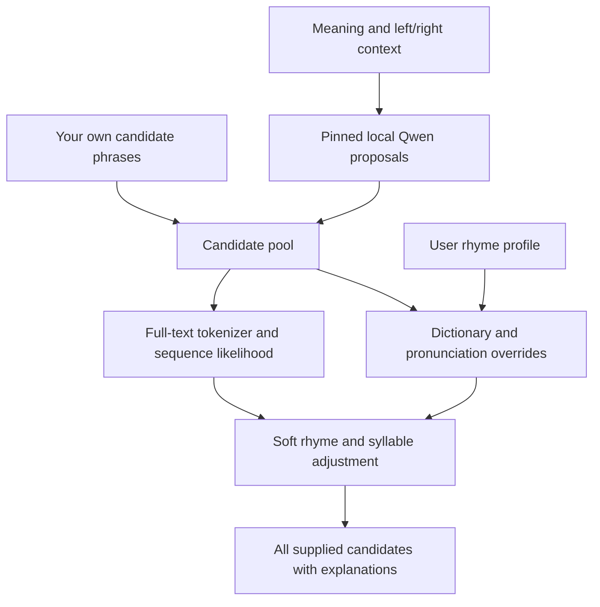

# Architecture and scoring boundaries

[Home](../README.md) · [Rhyme rules](rhyme-rules.md)

Version 0.1 exposes a local pronunciation and candidate-ranking layer. It does not modify the model's token distribution at each decoding step.



## Modules

| Module | Responsibility |
| --- | --- |
| `profile.py` | Validate YAML/JSON rules and request overlays |
| `phonetics.py` | Pronunciation alternatives, vowel/coda/stress comparison, dictionary search |
| `model.py` | Pinned tokenizer/model, finite proposals, teacher-forced likelihood |
| `checkpoint.py` | Byte-preserving Windows resharding to lower file-mapping peaks |
| `service.py` | Input validation and combined candidate ranking |
| `cli.py`, `server.py` | JSON CLI and stdio MCP over the same service |

## Phonetic layer

English readings come from CMUdict plus user overrides. A heuristic separates vowel nuclei and following consonants, compares the final N syllables, and combines vowel, coda, and stress weights. The default similarity is hand-designed; it is not a learned singing perception score. Explicit pair rules override the relevant vowel comparisons without building equivalence classes.

The best pronunciation pairing is returned, bounded to 32 paths per phrase. Unknown endings have an explicit positive fallback. Unknown interior words can leave a comparable known ending while making the complete syllable count unavailable. The response discloses these cases. All supplied candidates survive rhyme evaluation.

## Language layer and the fixed vocabulary

Qwen weights and tokenizer use the same immutable revision. Candidate phrases are not assumed to be single tokens. The adapter assembles prompt + left context + candidate + right context, tokenizes the complete string once, and selects token positions using character offsets. A token spanning the left/gap boundary is scored. Right context is also scored to account for the connection after the gap.

Scores are teacher-forced token log likelihoods. Ranking uses their mean to reduce raw sequence-length bias; this does not remove all length effects. The raw sum and number of scored tokens remain available. Model input is capped at 2,048 tokens with an explicit error on overflow. Selected output positions avoid materializing vocabulary logits for the entire prompt.

The Qwen proposal prompt asks for English JSON strings and a rhyme reference. Custom phonetic profiles currently affect the reranker, not the generation distribution. This finite proposal stage can miss an unconventional rhyme; supplying candidates is an important supported path.

## Combined ranking

```text
s(c) = mean_log_likelihood(c and right context | prompt and left context)
     + strength × log(rhyme_weight(c))
     + log(syllable_weight(c))
rank_weight(c) = softmax(s(c), over this candidate set)
```

When `use_model=false`, the language term is absent and mode is explicitly `phonetic_only`. A zero rhyme strength leaves language and optional syllable preferences. The phonetic score does not act as a hard gate. Stable normalization keeps ranking weights positive.

## Local execution

Model imports and weights are lazy; a lock serializes local model operations. The server retains the loaded model for a writing session. Downloads use Hugging Face; after complete caching, `HF_HUB_OFFLINE=1` permits local operation.

Windows uses standard smaller safetensors shards, copied by streaming raw tensor bytes. Cache preparation is locked and publishes its completed index last. The source snapshot remains untouched. The local integration record includes a comparison of all 775 tensor hashes. Windows also initializes optional NumPy before starting stdio reader threads to avoid the observed extension-import stall.

## Deliberate limits

English pronunciations only; Chinese text is creative intent. No audio transcription, automatic sung-vowel inference, accent model, artist corpus, or constrained-logit backend. This release makes user preferences explicit and inspectable while leaving final writing decisions with the creator.
